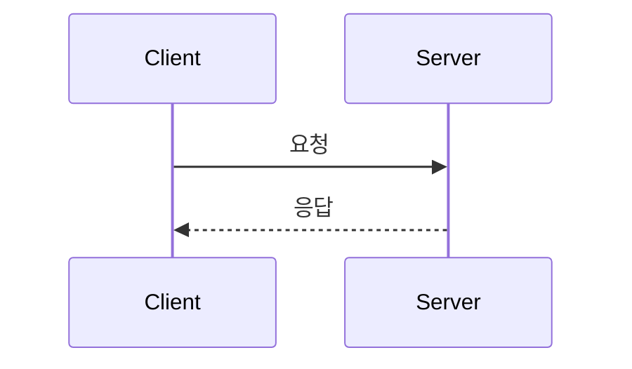

# [DOMAIN-000] 기능 이름

| 항목 | 내용 |
|---|---|
| 버전 | v0.0.0 |
| 상태 | 기획 / 개발중 / 완료 |
| 관련 이슈/PR | |

## 1. 개요
- **목적**: 왜 필요한가 (해결하려는 문제)
- **사용자 스토리**: "~로서, ~하고 싶다"

## 2. 범위
- 포함:
- 제외 (이번 버전에서 하지 않는 것):

## 3. 기능 요구사항
| ID | 요구사항 | 우선순위 |
|---|---|---|
| DOMAIN-000-1 | | Must |

## 4. 비즈니스 규칙 / 정책
-

## 5. 처리 흐름


## 6. API 명세
`METHOD /api/...`

**Request**
```json
{}
```

**Response**
```json
{}
```

**에러**
| HTTP | 코드 | 발생 조건 |
|---|---|---|

## 7. 데이터
- 엔티티/테이블 변경, Redis 키 구조, TTL

## 8. 예외 및 엣지 케이스
-

## 9. 비기능 요구사항
- 보안, 성능, 로그

## 10. 인수 조건
- [ ] Given … / When … / Then …

## 11. 변경 이력
| 버전 | 내용 |
|---|---|
