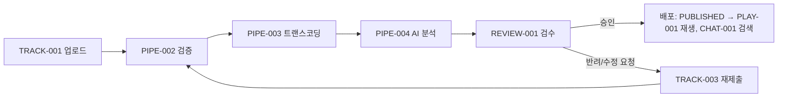

# v0.0.1

## 목표
- 이메일/비밀번호 인증과 JWT 기반 세션 유지(재발급, 로그아웃)를 제공합니다.
- 서비스 MVP(운영자 백오피스, 사용자 웹 화면)의 기능을 정의합니다.

> 인증 기능(AUTH-001, 002, 004~006)은 구현 완료 상태 기준이고, MVP 기능은 기획 단계입니다. 각 문서의 "상태"와 요구사항 표의 "구현" 열로 진행 상황을 확인하세요.

## 기능 목록

### 인증
| ID | 기능 | 상태 | 문서 |
|---|---|---|---|
| AUTH-001 | 회원가입 (이메일/비밀번호) | 완료 | [auth-signup.md](auth-signup.md) |
| AUTH-002 | 로그인 (이메일/비밀번호) | 완료 | [auth-login.md](auth-login.md) |
| AUTH-004 | 토큰 재발급 | 완료 | [auth-token-refresh.md](auth-token-refresh.md) |
| AUTH-005 | 로그아웃 | 완료 | [auth-logout.md](auth-logout.md) |
| AUTH-006 | 닉네임 중복 확인 | 완료 | [auth-nickname-check.md](auth-nickname-check.md) |

### MVP 1 — 운영자 백오피스
| ID | 기능 | 상태 | 문서 |
|---|---|---|---|
| ADMIN-001 | 운영 대시보드 | 기획 | [admin-dashboard.md](admin-dashboard.md) |
| REVIEW-001 | 음원 검수 대기열 | 기획 | [review-queue.md](review-queue.md) |
| PIPE-001 | 파이프라인 대시보드 및 재처리 | 기획 | [pipeline-dashboard.md](pipeline-dashboard.md) |
| PIPE-002 | ① 검증 | 기획 | [pipeline-validate.md](pipeline-validate.md) |
| PIPE-003 | ② 트랜스코딩 | 기획 | [pipeline-transcode.md](pipeline-transcode.md) |
| PIPE-004 | ③ AI 콘텐츠 분석 | 기획 | [pipeline-ai-analysis.md](pipeline-ai-analysis.md) |

### MVP 2 — 사용자 웹 화면
| ID | 기능 | 대상 | 상태 | 문서 |
|---|---|---|---|---|
| TRACK-001 | 음원 업로드 | 크리에이터 | 일부 구현 | [track-upload.md](track-upload.md) |
| TRACK-002 | 처리 상태 확인 | 크리에이터 | 일부 구현 | [track-status.md](track-status.md) |
| TRACK-003 | 반려 사유 확인 및 재제출 | 크리에이터 | 기획 | [track-resubmit.md](track-resubmit.md) |
| PLAY-001 | 음원 재생 | 일반 사용자 | 기획 | [track-playback.md](track-playback.md) |
| CHAT-001 | AI 음악 탐색 챗봇 | 일반 사용자 | 프로토타입 | [chatbot-music-explore.md](chatbot-music-explore.md) |
| AUTH-007 | 역할 기반 API 접근 제어 (후순위) | 공통 | 일부 구현 | [auth-rbac.md](auth-rbac.md) |

## 음원 처리 전체 흐름

## 제외 범위
- 휴대폰/이메일 본인 인증 → v0.0.2에서 휴대폰 SMS 인증 도입
- 소셜 로그인, 비밀번호 찾기/변경
- README "나중에 확장하면 좋을 것들": 크리에이터 제재, 신고 관리, 감사 로그 상세, Kafka 지표/DLQ, SSE 실시간 진행률, 음원 검색/좋아요/커뮤니티, 청취 이력 기반 추천
