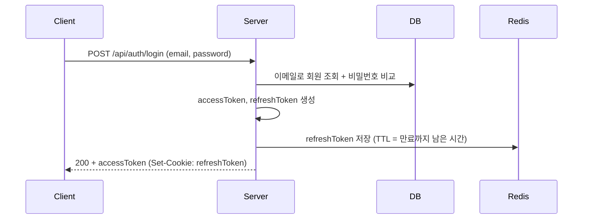

# [AUTH-002] 로그인

| 항목 | 내용 |
|---|---|
| 버전 | v0.0.1 |
| 상태 | 완료 |

## 1. 개요
- **목적**: 가입한 사용자가 인증 토큰을 받아 서비스를 이용한다.
- **사용자 스토리**: "가입한 사용자로서, 이메일과 비밀번호로 로그인하고 싶다."

## 2. 범위
- 포함: 이메일/비밀번호 확인, accessToken·refreshToken 발급
- 제외: 소셜 로그인, 로그인 실패 횟수 제한, 자동 로그인 옵션

## 3. 기능 요구사항
| ID | 요구사항 | 우선순위 |
|---|---|---|
| AUTH-002-1 | 이메일과 비밀번호가 일치하면 accessToken과 refreshToken을 발급한다 | Must |
| AUTH-002-2 | accessToken은 응답 바디로, refreshToken은 HttpOnly 쿠키로 전달한다 | Must |
| AUTH-002-3 | 이메일이 없거나 비밀번호가 틀리면 같은 오류로 응답한다 | Must |

## 4. 비즈니스 규칙 / 정책
- 존재하지 않는 이메일인지, 비밀번호가 틀렸는지 구분하지 않는다. (계정 존재 여부 노출 방지)
- accessToken 유효시간 15분, refreshToken 유효시간 1시간
- refreshToken은 만료 시각까지 Redis에 보관한다. (키: 사용자 ID)
- 로그인 실패는 감사 로그(`[AUDIT]`)로 남긴다.

## 5. 처리 흐름


## 6. API 명세
`POST /api/auth/login`

**Request**
```json
{
  "email": "user@example.com",
  "password": "Mx7#qPz9!"
}
```

**Response** `200 OK` (헤더 `Set-Cookie: refreshToken=...; HttpOnly`)

응답 바디는 `BaseResponse`로 감싸지 않고 DTO를 그대로 반환합니다. (v0.0.2에서 변경)
```json
{
  "accessToken": "eyJ...",
  "email": "user@example.com",
  "nickname": "user_1a2b3c4d",
  "role": "USER"
}
```

**에러**
| HTTP | 코드 | 발생 조건 |
|---|---|---|
| 400 | (공통 검증 오류) | 이메일/비밀번호 누락, 이메일 형식 오류 |
| 401 | AUTH_401_2 | 이메일 없음 또는 비밀번호 불일치 |

## 7. 데이터
- Redis: 사용자 ID → refreshToken (TTL = refreshToken 만료까지)

## 8. 예외 및 엣지 케이스
- 같은 사용자가 다시 로그인하면 Redis의 refreshToken을 새 값으로 덮어쓴다. (이전 기기의 refreshToken은 무효)

## 9. 비기능 요구사항
- refreshToken은 JS에서 읽을 수 없도록 HttpOnly 쿠키로만 전달한다.

## 10. 인수 조건
- [ ] Given 가입된 이메일과 올바른 비밀번호 / When 로그인 요청 / Then 200, accessToken, refreshToken 쿠키를 반환한다
- [ ] Given 가입된 이메일과 틀린 비밀번호 / When 로그인 요청 / Then 401(AUTH_401_2)을 반환한다
- [ ] Given 가입되지 않은 이메일 / When 로그인 요청 / Then 401(AUTH_401_2)을 반환한다
- [ ] Given 이메일 형식 오류 / When 로그인 요청 / Then 400을 반환한다

## 11. 변경 이력
| 버전 | 내용 |
|---|---|
| v0.0.1 | 최초 작성 (필터 방식으로 구현) |
| v0.0.2 | 컨트롤러-서비스 방식으로 변경, 응답을 `BaseResponse`로 감쌈 → [v0.0.2/auth-login.md](../v0.0.2/auth-login.md) |
