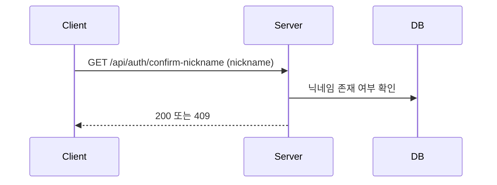

# [AUTH-006] 닉네임 중복 확인

| 항목 | 내용 |
|---|---|
| 버전 | v0.0.1 |
| 상태 | 완료 (v0.0.2에서 API 제거) |

## 1. 개요
- **목적**: 닉네임을 정하기 전에 이미 쓰고 있는 닉네임인지 확인한다.
- **사용자 스토리**: "사용자로서, 원하는 닉네임을 쓸 수 있는지 미리 확인하고 싶다."

## 2. 범위
- 포함: 닉네임 길이 검사, 중복 여부 확인
- 제외: 닉네임 변경, 금지어 검사

## 3. 기능 요구사항
| ID | 요구사항 | 우선순위 |
|---|---|---|
| AUTH-006-1 | 닉네임이 사용 중이 아니면 성공으로 응답한다 | Must |
| AUTH-006-2 | 이미 사용 중인 닉네임이면 409로 응답한다 | Must |
| AUTH-006-3 | 닉네임이 비어 있거나 2~20자가 아니면 400으로 응답한다 | Must |

## 4. 비즈니스 규칙 / 정책
- 닉네임 길이: 2~20자
- 확인만 하고 닉네임을 예약하지 않는다. (확인한 뒤 다른 사람이 먼저 쓸 수 있음)
- 회원가입에서는 닉네임을 자동 생성하므로([AUTH-001](auth-signup.md)), 이 API는 이후 닉네임 변경 기능을 위해 미리 만든 것이다.

## 5. 처리 흐름


## 6. API 명세
`GET /api/auth/confirm-nickname`

**Request** (JSON 바디)
```json
{ "nickname": "soundlover" }
```

**Response** `200 OK`
```json
{
  "isSuccess": true,
  "status": 200,
  "code": "OK_200",
  "message": "호출에 성공하였습니다.",
  "result": null,
  "timeStamp": "2026-11-07 12:00:00"
}
```

**에러**
| HTTP | 코드 | 발생 조건 |
|---|---|---|
| 400 | (공통 검증 오류) | 닉네임 누락 또는 길이 오류 |
| 409 | AUTH_409_2 | 이미 사용 중인 닉네임 |

## 7. 데이터
- `users.nickname` 조회만 함

## 8. 예외 및 엣지 케이스
- 대소문자만 다른 닉네임: 별도 정규화 없음 (DB 정렬 규칙을 따름)

## 9. 비기능 요구사항
- 없음

## 10. 인수 조건
- [ ] Given 사용 중이 아닌 닉네임 / When 중복 확인 요청 / Then 200을 반환한다
- [ ] Given 이미 사용 중인 닉네임 / When 중복 확인 요청 / Then 409(AUTH_409_2)를 반환한다
- [ ] Given 1자 닉네임 / When 중복 확인 요청 / Then 400을 반환한다

## 11. 미결 사항
- GET 요청인데 값을 JSON 바디로 받는다. 브라우저 `fetch`를 비롯한 많은 클라이언트와 프록시가 GET 바디를 보내지 않거나 버리므로, 다시 만든다면 쿼리 파라미터(`?nickname=`)로 받아야 한다.

## 12. 변경 이력
| 버전 | 내용 |
|---|---|
| v0.0.1 | 최초 작성 |
| v0.0.2 | API 제거 (서비스 메서드 `confirmDuplicateNickname`은 남아 있음) |
