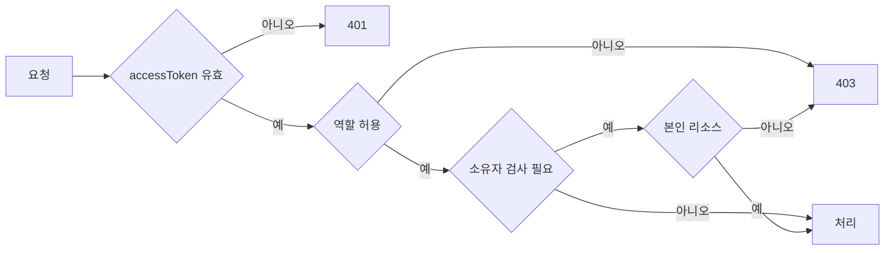

# [AUTH-007] 역할 기반 API 접근 제어

| 항목 | 내용 |
|---|---|
| 버전 | v0.0.1 |
| 구분 | MVP 2 — 공통 인증 (후순위) |
| 상태 | 일부 구현 (JWT 인증, 업로드 API의 CREATOR 검사) |

## 1. 개요
- **목적**: 일반 사용자, 크리에이터, 운영자가 각자 허용된 API만 호출하게 한다.
- JWT 발급/재발급은 [AUTH-002](auth-login.md), [AUTH-004](auth-token-refresh.md)를 따른다.

## 2. 범위
- 포함: 역할별 URL 접근 규칙, 403 응답 형식, 리소스 소유자 검사
- 제외: 역할 변경(크리에이터 신청/승인) 기능, 세분화된 권한(permission)

## 3. 기능 요구사항
| ID | 요구사항 | 우선순위 | 구현 |
|---|---|---|---|
| AUTH-007-1 | 인증이 필요한 API는 유효한 accessToken이 없으면 401을 반환한다 | Must | ✅ |
| AUTH-007-2 | 역할이 맞지 않으면 403을 공통 에러 형식으로 반환한다 | Must | ❌ |
| AUTH-007-3 | `/api/admin/**`는 `ADMIN`만 호출할 수 있다 | Must | ❌ |
| AUTH-007-4 | 음원 등록/재제출은 `CREATOR`만 할 수 있다 | Must | ✅ (서비스에서 검사) |
| AUTH-007-5 | 본인 리소스(내 음원 상태, 재제출)는 소유자만 접근할 수 있다 | Must | ❌ |
| AUTH-007-6 | 운영용 actuator 엔드포인트는 외부에 공개하지 않는다 | Must | ❌ |

## 4. 비즈니스 규칙 / 정책
| 경로 | USER | CREATOR | ADMIN |
|---|---|---|---|
| `/api/auth/**` | 공개 | 공개 | 공개 |
| `GET /api/tracks/public`, `/api/tracks/{id}/stream`, `/api/chat` | ✅ | ✅ | ✅ |
| `POST /api/tracks`, `GET /api/tracks`, `/api/tracks/{id}/progress|reviews|resubmit` | ❌ | ✅ (본인) | ❌ |
| `/api/admin/**` | ❌ | ❌ | ✅ |
| `/api/webhooks/s3-events` | 스토리지 전용 (서명/비밀 헤더 검증) |||

- 역할 검사는 URL 규칙(`SecurityConfig`) 또는 `@PreAuthorize`로 한 곳에서 하고, 서비스 안에서 역할을 직접 비교하지 않는다.
- 역할은 accessToken에 담긴 값을 쓴다. 역할이 바뀌면 다음 accessToken 발급부터 반영된다. (최대 15분 지연)

## 5. 처리 흐름


## 6. API 명세
새 API 없음. 403 응답 형식:
```json
{
  "isSuccess": false,
  "status": 403,
  "code": "GLOBAL_403",
  "message": "해당 요청에 접근 권한이 없습니다.",
  "result": null,
  "timeStamp": "2026-11-07 12:00:00"
}
```

## 7. 데이터
- `users.role`: `USER` / `CREATOR` / `ADMIN`

## 8. 예외 및 엣지 케이스
- ADMIN이 크리에이터 API를 호출하면 403 (운영자는 업로드하지 않음)

## 9. 비기능 요구사항
- 접근 거부(403)는 감사 로그로 남긴다.

## 10. 인수 조건
- [ ] Given 토큰 없음 / When `/api/tracks` 호출 / Then 401
- [ ] Given USER 토큰 / When `/api/admin/dashboard` 호출 / Then 403, 공통 에러 형식
- [ ] Given ADMIN 토큰 / When `/api/admin/dashboard` 호출 / Then 200
- [ ] Given CREATOR A 토큰 / When B의 음원 진행 상태 조회 / Then 403
- [ ] Given 토큰 없음 / When `/actuator/heapdump` 호출 / Then 401 또는 404

## 11. 미결 사항
- **보안 설정 즉시 수정 필요**: `SecurityConfig`에서 `/actuator/env`, `/actuator/heapdump`, `/actuator/loggers`가 `permitAll`이다. heapdump와 env는 JWT secret, DB 비밀번호, API 키를 그대로 노출할 수 있다.
- `accessDeniedHandler`가 주석 처리되어 있어 403 응답 형식이 공통 형식과 다르다.
- `TrackService`가 역할을 직접 비교한다. URL 규칙 또는 `@PreAuthorize`로 옮긴다.

## 12. 변경 이력
| 버전 | 내용 |
|---|---|
| v0.0.1 | 최초 작성 |
