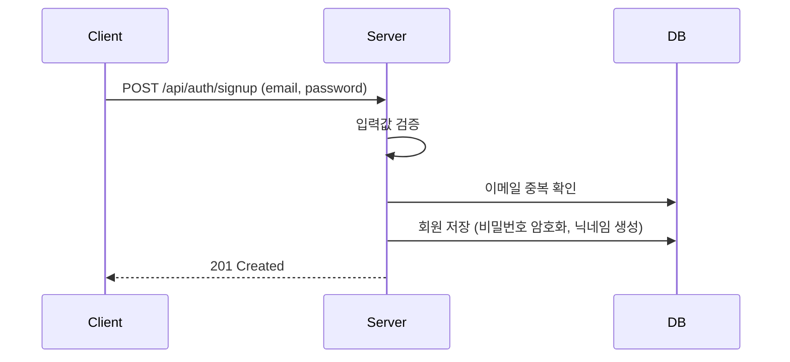

# [AUTH-001] 회원가입

| 항목 | 내용 |
|---|---|
| 버전 | v0.0.1 |
| 상태 | 완료 |

## 1. 개요
- **목적**: 서비스를 이용할 계정을 만든다.
- **사용자 스토리**: "처음 방문한 사용자로서, 이메일과 비밀번호만으로 간단히 가입하고 싶다."

## 2. 범위
- 포함: 이메일 형식 검사, 비밀번호 규칙 검사, 이메일 중복 검사, 닉네임 자동 생성
- 제외: 본인 인증(휴대폰/이메일), 닉네임 직접 입력

## 3. 기능 요구사항
| ID | 요구사항 | 우선순위 |
|---|---|---|
| AUTH-001-1 | 이메일과 비밀번호를 입력받아 회원을 생성한다 | Must |
| AUTH-001-2 | 이메일 형식이 올바르지 않거나 비어 있으면 가입할 수 없다 | Must |
| AUTH-001-3 | 비밀번호 규칙을 만족하지 않으면 가입할 수 없다 | Must |
| AUTH-001-4 | 이미 가입된 이메일로는 가입할 수 없다 | Must |
| AUTH-001-5 | 닉네임은 `user_` + 랜덤 8자리로 자동 생성한다 | Must |

## 4. 비즈니스 규칙 / 정책
- **비밀번호 규칙**: 8~64자, 영문자·숫자·특수문자를 각각 1개 이상 포함, 공백 불가
- 비밀번호는 암호화(PasswordEncoder)해서 저장한다.
- 닉네임이 겹치면 최대 5번 다시 생성하고, 그래도 겹치면 실패한다.
- 가입한 회원의 권한은 기본값 `USER`이다.

## 5. 처리 흐름


## 6. API 명세
`POST /api/auth/signup`

**Request**
```json
{
  "email": "user@example.com",
  "password": "Mx7#qPz9!"
}
```

**Response** `201 Created`
```json
{
  "isSuccess": true,
  "status": 201,
  "code": "CREATED_201",
  "message": "생성에 성공하였습니다.",
  "result": {
    "id": 1,
    "email": "user@example.com",
    "nickname": "user_1a2b3c4d",
    "role": "USER"
  },
  "timeStamp": "2026-11-07 12:00:00"
}
```

**에러**
| HTTP | 코드 | 발생 조건 |
|---|---|---|
| 400 | (공통 검증 오류) | 이메일/비밀번호 누락, 형식 오류, 비밀번호 규칙 위반 |
| 409 | AUTH_409_1 | 이미 가입된 이메일 |
| 409 | AUTH_409_2 | 닉네임 자동 생성 5회 모두 중복 |

## 7. 데이터
`users` 테이블: `id`, `email`(unique), `password`(암호화), `nickname`, `role`

## 8. 예외 및 엣지 케이스
- 이메일 대소문자만 다른 경우: 별도 정규화 없음 (다른 이메일로 취급)

## 9. 비기능 요구사항
- 평문 비밀번호를 저장하거나 로그에 남기지 않는다.

## 10. 인수 조건
- [ ] Given 가입되지 않은 이메일과 규칙에 맞는 비밀번호 / When 회원가입 요청 / Then 201과 함께 회원이 생성된다
- [ ] Given 이메일 형식 오류 / When 회원가입 요청 / Then 400을 반환한다
- [ ] Given 특수문자가 없는 비밀번호 / When 회원가입 요청 / Then 400을 반환한다
- [ ] Given 이미 가입된 이메일 / When 회원가입 요청 / Then 409(AUTH_409_1)를 반환한다

## 11. 변경 이력
| 버전 | 내용 |
|---|---|
| v0.0.1 | 최초 작성 |
| v0.0.2 | 휴대폰 인증 필수화, 비밀번호 규칙 강화 → [v0.0.2/auth-signup.md](../v0.0.2/auth-signup.md) |
