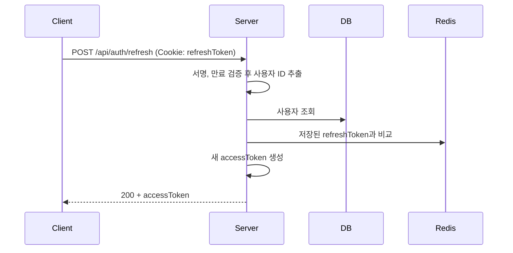

# [AUTH-004] 토큰 재발급

| 항목 | 내용 |
|---|---|
| 버전 | v0.0.1 |
| 상태 | 완료 |

## 1. 개요
- **목적**: accessToken이 만료되어도 다시 로그인하지 않고 새 accessToken을 받는다.
- **사용자 스토리**: "로그인한 사용자로서, 짧은 시간마다 다시 로그인하지 않고 계속 서비스를 쓰고 싶다."

## 2. 범위
- 포함: refreshToken 쿠키로 accessToken 재발급
- 제외: refreshToken 재발급(Rotation), 여러 기기 동시 로그인 관리

## 3. 기능 요구사항
| ID | 요구사항 | 우선순위 |
|---|---|---|
| AUTH-004-1 | 쿠키의 refreshToken이 유효하면 새 accessToken을 발급한다 | Must |
| AUTH-004-2 | refreshToken은 클라이언트가 바디로 보내지 않고 서버가 쿠키에서 읽는다 | Must |
| AUTH-004-3 | Redis에 저장된 refreshToken과 다르면 재발급하지 않는다 | Must |

## 4. 비즈니스 규칙 / 정책
- accessToken 유효시간 15분, refreshToken 유효시간 1시간
- refreshToken은 재발급하지 않는다. 만료되면 다시 로그인해야 한다.
- 다음 경우는 모두 같은 오류(AUTH_401_1)로 응답한다.
  - 쿠키 없음, 서명 오류 또는 만료
  - 토큰의 사용자 ID가 없거나 형식이 잘못됨
  - Redis에 저장된 토큰이 없음 (로그아웃함) 또는 저장된 토큰과 다름 (다른 곳에서 다시 로그인함)

## 5. 처리 흐름


## 6. API 명세
`POST /api/auth/refresh`

**Request**: 바디 없음, 쿠키 `refreshToken`

**Response** `200 OK` (`BaseResponse`로 감싸지 않음)
```json
{
  "accessToken": "eyJ...",
  "email": "user@example.com",
  "nickname": "user_1a2b3c4d",
  "role": "USER"
}
```

**에러**
| HTTP | 코드 | 발생 조건 |
|---|---|---|
| 401 | AUTH_401_1 | refreshToken 없음, 만료, 위조, Redis 값과 불일치 |

## 7. 데이터
- Redis: 사용자 ID → refreshToken 조회 (변경 없음)

## 8. 예외 및 엣지 케이스
- 같은 계정으로 다른 기기에서 로그인하면 Redis 값이 바뀌므로, 이전 기기의 재발급은 실패한다.
- 회원이 삭제된 경우 토큰이 유효해도 401을 반환한다.

## 9. 비기능 요구사항
- 실패 원인을 응답에서 구분하지 않는다. (토큰 상태 노출 방지)

## 10. 인수 조건
- [ ] Given 로그인 후 받은 유효한 refreshToken 쿠키 / When 재발급 요청 / Then 200과 새 accessToken을 반환한다
- [ ] Given refreshToken 쿠키 없음 / When 재발급 요청 / Then 401(AUTH_401_1)을 반환한다
- [ ] Given 만료되었거나 위조된 refreshToken / When 재발급 요청 / Then 401(AUTH_401_1)을 반환한다
- [ ] Given 로그아웃한 사용자의 refreshToken / When 재발급 요청 / Then 401(AUTH_401_1)을 반환한다
- [ ] Given 다시 로그인하기 전의 이전 refreshToken / When 재발급 요청 / Then 401(AUTH_401_1)을 반환한다

## 11. 미결 사항
- Swagger 설명에는 "accessToken과 refreshToken을 재발급"이라고 되어 있지만, 실제로는 accessToken만 재발급한다.
- 성공 응답이 `BaseResponse`로 감싸져 있지 않아 다른 API와 형식이 다르다.

## 12. 변경 이력
| 버전 | 내용 |
|---|---|
| v0.0.1 | 최초 작성 |
