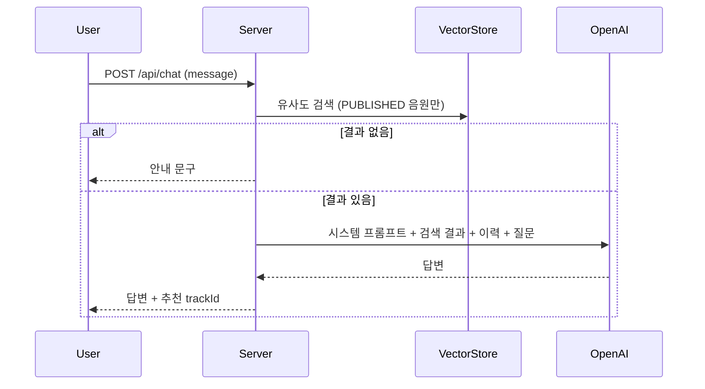

# [CHAT-001] AI 음악 탐색 챗봇

| 항목 | 내용 |
|---|---|
| 버전 | v0.0.1 |
| 구분 | MVP 2 — 일반 사용자 |
| 상태 | 프로토타입 (RAG 구조만 구현, 목적이 다름) |

## 1. 개요
- **목적**: 사용자가 대화로 SoundHub의 음원을 찾는다.
- **사용자 스토리**: "일반 사용자로서, '비 오는 날 듣기 좋은 발라드'처럼 말로 곡을 찾고 싶다."

## 2. 범위
- 포함: 최신 음악 안내, 장르 추천, 가사/크리에이터로 곡 찾기
- 제외: 청취 이력 기반 개인화 추천 (README "나중에 확장")

## 3. 기능 요구사항
| ID | 요구사항 | 우선순위 | 구현 |
|---|---|---|---|
| CHAT-001-1 | 사용자 질문과 비슷한 곡을 벡터 검색으로 찾아 그 결과만 근거로 답한다 | Must | ✅ (대상 데이터 다름) |
| CHAT-001-2 | 검색 결과가 없으면 LLM을 호출하지 않고 안내 문구를 반환한다 | Must | ✅ |
| CHAT-001-3 | 검색 대상은 `PUBLISHED` 음원의 제목, 크리에이터, 장르, 설명, 가사다 | Must | ❌ |
| CHAT-001-4 | 음원이 공개되면 임베딩을 추가하고, 비공개되면 제거한다 | Must | ❌ |
| CHAT-001-5 | 답변에 추천 곡의 trackId를 함께 돌려줘 바로 재생할 수 있게 한다 | Should | ❌ |
| CHAT-001-6 | 대화 이력은 사용자별로 분리한다 | Must | ❌ |
| CHAT-001-7 | "최신 음악" 질문은 공개일 기준 최신 곡을 DB에서 조회해 답한다 | Should | ❌ |

## 4. 비즈니스 규칙 / 정책
- 검색 유사도 기준값 0.75 (현재 값)
- 모델 `gpt-4o`, 최대 500토큰, temperature 0.5 (현재 값)
- 근거 없는 곡을 지어내지 않는다. 답변의 곡은 모두 검색 결과에 있어야 한다.
- 대화 이력은 최근 N턴만 프롬프트에 넣는다. (제안: 10턴)

## 5. 처리 흐름


## 6. API 명세

### 현재
`GET /api/chat?msg=...` → 답변 문자열 (text/plain)

### 제안
`POST /api/chat` · 인증 필요

**Request**
```json
{ "message": "비 오는 날 듣기 좋은 발라드 추천해줘" }
```

**Response** `200 OK`
```json
{
  "answer": "이런 곡은 어떠세요? ...",
  "tracks": [ { "trackId": 12, "title": "Midnight Drive", "creatorNickname": "user_1a2b3c4d" } ]
}
```

**에러**
| HTTP | 발생 조건 |
|---|---|
| 400 | 메시지 누락 또는 너무 김 (제안: 500자) |
| 502 | OpenAI 호출 실패 |

## 7. 데이터
- VectorStore 문서 메타데이터: `type=track`, `trackId`

## 8. 예외 및 엣지 케이스
- 비공개 처리된 곡이 임베딩에 남아 있으면 추천되면 안 된다. → 검색 시 메타데이터 필터 + 공개 상태 재확인

## 9. 비기능 요구사항
- OpenAI 호출 비용 제한: 사용자당 요청 횟수 제한 (제안: 분당 10회)
- 사용자 입력을 로그에 남길 때 개인정보 마스킹

## 10. 인수 조건
- [ ] Given 공개된 발라드 곡 / When "발라드 추천해줘" / Then 그 곡이 tracks에 포함된다
- [ ] Given 관련 곡 없음 / When 질문 / Then LLM 호출 없이 안내 문구를 반환한다
- [ ] Given 반려된 곡의 가사로 질문 / When 질문 / Then 그 곡은 추천되지 않는다
- [ ] Given 사용자 A의 대화 / When 사용자 B가 질문 / Then A의 이력이 프롬프트에 들어가지 않는다

## 11. 미결 사항
- **현재 구현은 다른 서비스용이다.** 시스템 프롬프트가 "아티스트 팬 전용 챗봇"(콘서트, 응원법)이고, 검색 대상도 `Song`(응원법, 가사) 테이블이다. SoundHub 음악 탐색용으로 프롬프트와 데이터 소스를 `Track` 기준으로 바꿔야 한다.
- 대화 이력이 모든 사용자 공용(`default` 키)이고 메모리에만 있어 무한히 쌓인다.
- 임베딩이 앱 시작 시(`SongEmbeddingRunner`)에만 수행된다. 음원 공개 이벤트에 맞춰 추가해야 한다.

## 12. 변경 이력
| 버전 | 내용 |
|---|---|
| v0.0.1 | 최초 작성 |
