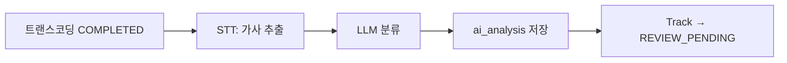

# [PIPE-004] 파이프라인 ③ AI 콘텐츠 분석

| 항목 | 내용 |
|---|---|
| 버전 | v0.0.1 |
| 구분 | MVP 1 — 파이프라인 |
| 상태 | 기획 (엔티티만 있음) |

## 1. 개요
- **목적**: 가사가 정책상 문제없는지 판단해 운영자 검수를 돕는다.
- **사용자 스토리**: "운영자로서, 모든 곡을 처음부터 끝까지 듣지 않고 문제 가능성이 있는 곡을 먼저 보고 싶다."

## 2. 범위
- 포함: STT로 가사 추출, LLM으로 부적절 콘텐츠 분류
- 제외: 저작권 의심, 위험도 점수, 성인 인증 필요 판별 (README "나중에 확장")

## 3. 기능 요구사항
| ID | 요구사항 | 우선순위 |
|---|---|---|
| PIPE-004-1 | 고음질 파일에서 STT로 가사 텍스트를 추출한다 | Must |
| PIPE-004-2 | LLM으로 가사를 분류해 부적절 여부(`inappropriateFlag`)를 판단한다 | Must |
| PIPE-004-3 | 부적절로 판단한 근거(카테고리, 해당 구절)를 함께 저장한다 | Should |
| PIPE-004-4 | 분석이 끝나면 음원 상태를 `REVIEW_PENDING`으로 바꿔 검수 대기열에 올린다 | Must |
| PIPE-004-5 | AI 결과는 참고용이며, 자동 반려하지 않는다 | Must |

## 4. 비즈니스 규칙 / 정책
- **부적절 카테고리 (제안)**: 욕설, 혐오/차별, 성적 표현, 폭력, 약물
- 연주곡처럼 가사가 없으면 `lyricsText`를 비우고 `inappropriateFlag=false`로 저장한다.
- 크리에이터가 입력한 가사(`tracks.lyrics`)가 있으면 STT 결과와 함께 분류에 넣는다.
- 외부 API 오류는 자동 재시도 3회, 그래도 실패하면 `FAILED`. 이때 운영자가 AI 결과 없이 검수로 넘길 수 있다.

## 5. 처리 흐름

## 6. API 명세
외부 API 없음. 결과는 검수 화면([REVIEW-001](review-queue.md))에서 조회한다.

## 7. 데이터
- `ai_analysis`: `track_id`, `inappropriate_flag`, `lyrics_text`
- 추가 제안: `categories`(JSON), `evidence`(TEXT), `model`(사용한 모델 이름)

## 8. 예외 및 엣지 케이스
- LLM 응답이 정해진 JSON 형식이 아니면 재시도하고, 계속 실패하면 `FAILED`
- 외국어 가사: STT 언어 자동 감지

## 9. 비기능 요구사항
- 비용: 곡당 STT + LLM 1회. 재처리 시에도 이미 성공한 STT 결과는 재사용한다.
- 프롬프트에 들어가는 가사는 사용자 입력이므로, 분류 지시를 덮어쓰는 문장(프롬프트 주입)에 영향받지 않도록 구조화된 출력을 사용한다.

## 10. 인수 조건
- [ ] Given 욕설이 포함된 곡 / When AI 분석 / Then inappropriateFlag=true, 카테고리에 욕설이 기록된다
- [ ] Given 문제없는 곡 / When AI 분석 / Then inappropriateFlag=false이고 REVIEW_PENDING이 된다
- [ ] Given 연주곡 / When AI 분석 / Then lyricsText가 비고 inappropriateFlag=false
- [ ] Given STT API 장애 / When 3회 재시도 후 실패 / Then FAILED와 오류 코드가 기록된다

## 11. 미결 사항
- STT/LLM 제공자와 모델 선택 (현재 프로젝트는 Spring AI + OpenAI를 쓰고 있음)

## 12. 변경 이력
| 버전 | 내용 |
|---|---|
| v0.0.1 | 최초 작성 |
