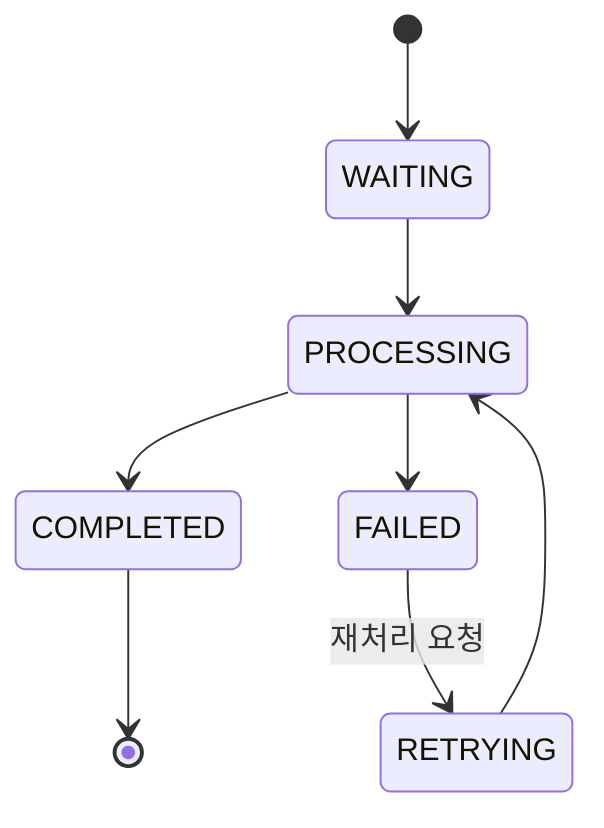
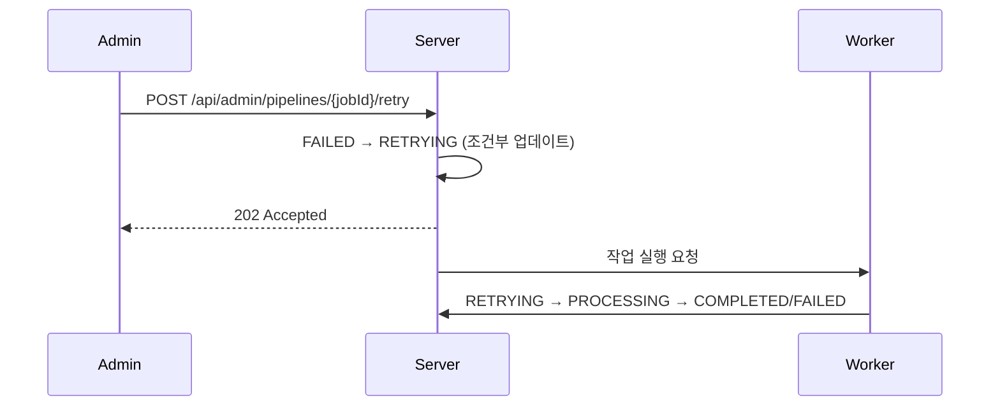

# [PIPE-001] 파이프라인 대시보드 및 재처리

| 항목 | 내용 |
|---|---|
| 버전 | v0.0.1 |
| 구분 | MVP 1 — 운영자 백오피스 |
| 상태 | 기획 (엔티티, enum만 있음) |

## 1. 개요
- **목적**: 운영자가 모든 음원의 처리 단계와 작업 상태를 보고, 실패한 작업을 다시 실행한다.
- **사용자 스토리**: "운영자로서, 어느 곡이 어느 단계에서 왜 실패했는지 보고 바로 재처리하고 싶다."

## 2. 범위
- 포함: 단계별 작업 목록/상태 조회, 실패 작업 단건 재처리, 단계별 일괄 재처리, 멱등성 보장
- 제외: Retry Topic/DLQ 상세, Kafka 이벤트 이력, SSE 실시간 진행률 (README "나중에 확장")

## 3. 기능 요구사항
| ID | 요구사항 | 우선순위 |
|---|---|---|
| PIPE-001-1 | 처리 단계: 등록 요청 → 검증 → 트랜스코딩 → AI 분석 → 검수 → 배포 | Must |
| PIPE-001-2 | 작업 상태: `WAITING` / `PROCESSING` / `COMPLETED` / `FAILED` / `RETRYING` | Must |
| PIPE-001-3 | 단계, 상태, 기간, 음원명으로 작업 목록을 필터링한다 | Must |
| PIPE-001-4 | 작업 상세에서 오류 코드, 재시도 횟수, 시작/종료 시각을 본다 | Must |
| PIPE-001-5 | `FAILED` 작업을 단건으로 재처리한다 | Must |
| PIPE-001-6 | 특정 단계의 `FAILED` 작업을 일괄 재처리한다 | Must |
| PIPE-001-7 | 작업 ID 기준으로 중복 실행을 막는다 (멱등성) | Must |
| PIPE-001-8 | 재처리는 실패한 단계부터 시작하고, 이미 완료된 앞 단계는 다시 하지 않는다 | Must |

## 4. 비즈니스 규칙 / 정책
- **상태 전이**



- **멱등성**: 작업 시작 시 `WAITING|RETRYING → PROCESSING` 조건부 업데이트(낙관적 락 또는 `UPDATE ... WHERE status IN (...)`)에 성공한 워커만 실행한다. `PROCESSING`/`COMPLETED` 작업에 재처리를 요청하면 409.
- 재처리할 때마다 `retry_count`를 1 올린다. 수동 재처리 상한 (제안: 5회)
- `PROCESSING`이 일정 시간(제안: 30분) 넘게 바뀌지 않으면 "멈춘 작업"으로 대시보드에 표시한다.
- 검수(REVIEW) 단계는 운영자 결정으로 끝나므로 재처리 대상이 아니다.

## 5. 처리 흐름


## 6. API 명세 (제안) · 모두 `ADMIN` 전용

### 6-1. 작업 목록
`GET /api/admin/pipelines?stage=TRANSCODING&status=FAILED&from=2026-11-01&to=2026-11-07&q=Midnight&page=0&size=20`

```json
{
  "content": [
    { "jobId": 301, "trackId": 12, "trackTitle": "Midnight Drive", "stage": "TRANSCODING", "status": "FAILED",
      "retryCount": 1, "errorCode": "FFMPEG_TIMEOUT", "startedAt": "2026-11-07T12:00:00", "updatedAt": "2026-11-07T12:10:00" }
  ],
  "page": 0, "size": 20, "totalElements": 1
}
```

### 6-2. 음원별 단계 현황
`GET /api/admin/tracks/{trackId}/pipelines` → 단계별 최신 작업 목록

### 6-3. 단건 재처리
`POST /api/admin/pipelines/{jobId}/retry` → `202 Accepted`

### 6-4. 단계별 일괄 재처리
`POST /api/admin/pipelines/retry` · Body `{ "stage": "TRANSCODING" }` → `202` + `{ "requested": 7 }`

**에러**
| HTTP | 발생 조건 |
|---|---|
| 403 | `ADMIN`이 아님 |
| 404 | 작업 없음 |
| 409 | `FAILED`가 아닌 작업 재처리, 재처리 상한 초과 |

## 7. 데이터
- `pipeline`: `track_id`, `stage`, `status`, `retry_count`, `error_code`, `started_at`, `updated_at`
- 추가 제안: `finished_at`, `version`(낙관적 락)

## 8. 예외 및 엣지 케이스
- 운영자 두 명이 같은 작업을 동시에 재처리 → 한 명만 성공, 나머지는 409
- 일괄 재처리 도중 일부가 상태가 바뀜 → 조건부 업데이트에 성공한 것만 실행하고 개수를 반환

## 9. 비기능 요구사항
- 목록 조회는 `(stage, status, started_at)` 인덱스 사용
- 재처리 요청은 감사 로그(운영자 ID, 작업 ID)를 남긴다.

## 10. 인수 조건
- [ ] Given FAILED 작업 / When 단건 재처리 / Then 202, RETRYING을 거쳐 실행된다
- [ ] Given COMPLETED 작업 / When 재처리 / Then 409
- [ ] Given 같은 FAILED 작업에 동시 재처리 2건 / When 요청 / Then 작업은 한 번만 실행된다
- [ ] Given 트랜스코딩 FAILED 3건 / When 단계별 일괄 재처리 / Then 3건이 재실행되고 requested=3
- [ ] Given 트랜스코딩 단계에서 실패한 음원 / When 재처리 / Then 검증 단계는 다시 실행되지 않는다
- [ ] Given USER 토큰 / When 목록 조회 / Then 403

## 11. 미결 사항
- 음원 하나에 단계별 행을 하나만 두고 갱신할지, 시도마다 행을 쌓을지 (이력 보존 vs 조회 단순성)
- 보안 설정에 403 처리기(`accessDeniedHandler`)가 주석 처리되어 있다. 역할 기반 접근 제어([AUTH-007](auth-rbac.md))와 함께 정해야 한다.

## 12. 변경 이력
| 버전 | 내용 |
|---|---|
| v0.0.1 | 최초 작성 |
