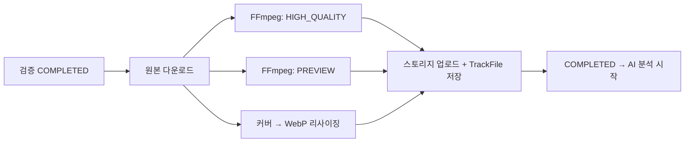

# [PIPE-003] 파이프라인 ② 트랜스코딩

| 항목 | 내용 |
|---|---|
| 버전 | v0.0.1 |
| 구분 | MVP 1 — 파이프라인 |
| 상태 | 기획 |

## 1. 개요
- **목적**: 검증된 원본을 서비스용 파일(고음질 스트리밍, 미리듣기)로 바꾸고, 커버 이미지를 최적화한다.

## 2. 범위
- 포함: 고음질 변환, 미리듣기 생성, 커버 이미지 WebP 변환 + 리사이징
- 제외: HLS/DASH 분할 스트리밍, 음량 평준화(loudness normalization)

## 3. 기능 요구사항
| ID | 요구사항 | 결과 FileType | 우선순위 |
|---|---|---|---|
| PIPE-003-1 | 원본을 고음질 스트리밍용 파일로 변환한다 | `HIGH_QUALITY` | Must |
| PIPE-003-2 | 미리듣기 파일을 만든다 | `PREVIEW` | Must |
| PIPE-003-3 | 커버 이미지를 WebP로 변환하고 리사이징한다 | `THUMBNAIL_OPTIMIZED` | Must |
| PIPE-003-4 | FFmpeg는 서브프로세스로 직접 호출한다 | — | Must |
| PIPE-003-5 | 결과 파일의 스펙(포맷, 비트레이트, 길이/이미지 크기)을 기록한다 | — | Must |
| PIPE-003-6 | 성공하면 AI 분석 단계를 시작한다 | — | Must |

## 4. 비즈니스 규칙 / 정책 (제안 값)
| 산출물 | 사양 |
|---|---|
| 고음질 | AAC 256kbps (`.m4a`), 원본 샘플레이트 유지 (최대 48kHz) |
| 미리듣기 | AAC 128kbps, 30초 (곡 길이의 1/3 지점부터, 앞뒤 2초 페이드) |
| 커버 이미지 | WebP, 500×500 정사각형 중앙 크롭, 품질 80 |

- 저장 경로: `tracks/{trackId}/hq/`, `tracks/{trackId}/preview/`, `tracks/{trackId}/thumbnail/optimized/`
- 일시적 오류(스토리지, 프로세스 타임아웃)는 자동 재시도 3회, 그 뒤 `FAILED`

## 5. 처리 흐름

## 6. API 명세
외부 API 없음. 재처리는 [PIPE-001](pipeline-dashboard.md).

## 7. 데이터
- `track_files`: 산출물마다 행 추가 (`file_type`, `storage_path`, `format`, `bitrate`, `duration_sec`, `image_size`)
- `pipeline`: `stage=TRANSCODING`

## 8. 예외 및 엣지 케이스
- 곡이 30초보다 짧으면 미리듣기는 곡 전체로 한다.
- 재처리 시 이미 만든 산출물은 덮어쓴다. (같은 경로, TrackFile은 upsert) → 멱등성

## 9. 비기능 요구사항
- FFmpeg 프로세스 타임아웃 (제안: 곡 길이 × 2, 최대 10분), 종료 시 프로세스 강제 종료
- 동시 트랜스코딩 수 제한 (제안: CPU 코어 수)
- FFmpeg 인자는 고정 템플릿으로 만들고, 사용자 입력(파일명)을 명령어에 직접 넣지 않는다.

## 10. 인수 조건
- [ ] Given 검증 통과한 3분 wav / When 트랜스코딩 / Then HIGH_QUALITY, PREVIEW(30초), THUMBNAIL_OPTIMIZED가 생성된다
- [ ] Given 20초 곡 / When 트랜스코딩 / Then PREVIEW 길이가 20초다
- [ ] Given FFmpeg 비정상 종료 / When 3회 재시도 후에도 실패 / Then FAILED와 오류 코드가 기록된다
- [ ] Given 이미 COMPLETED인 작업 / When 같은 작업 ID로 다시 실행 / Then 산출물이 중복 생성되지 않는다

## 11. 미결 사항
- 작업을 어떻게 비동기로 실행할지 (스프링 `@Async` + DB 작업 테이블 / 메시지 큐). README에서 Kafka는 "나중에 확장"으로 되어 있다.

## 12. 변경 이력
| 버전 | 내용 |
|---|---|
| v0.0.1 | 최초 작성 |
