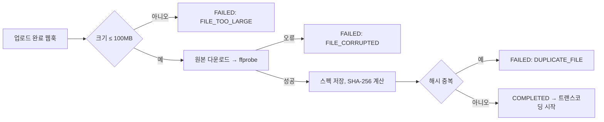

# [PIPE-002] 파이프라인 ① 검증

| 항목 | 내용 |
|---|---|
| 버전 | v0.0.1 |
| 구분 | MVP 1 — 파이프라인 |
| 상태 | 기획 (서비스 메서드 골격만 있음) |

## 1. 개요
- **목적**: 업로드된 원본이 서비스할 수 있는 정상 오디오인지 확인하고 스펙을 추출한다.
- **사용자 스토리**: "운영자로서, 손상되었거나 중복된 파일이 검수 대기열까지 오지 않았으면 한다."

## 2. 범위
- 포함: 스펙 추출, 크기 제한, 중복 검사, 손상 여부
- 후순위: MIME 타입 검사, 매직바이트 검사

## 3. 기능 요구사항
| ID | 검사 | 확인 내용 | 실패 코드 (제안) | 우선순위 |
|---|---|---|---|---|
| PIPE-002-1 | 스펙 추출 | ffprobe로 재생시간, 코덱, 비트레이트를 읽어 `track_files`에 저장 | — | Must |
| PIPE-002-2 | 최대 크기 | 100MB 초과 거부 | `FILE_TOO_LARGE` | Must |
| PIPE-002-3 | 중복 업로드 | 파일 SHA-256 해시가 기존 파일과 같으면 거부 | `DUPLICATE_FILE` | Must |
| PIPE-002-4 | 손상 여부 | ffprobe가 오류 없이 메타데이터를 읽는지 | `FILE_CORRUPTED` | Must |
| PIPE-002-5 | MIME 타입 | 파일 내용 기반으로 실제 오디오인지 | `INVALID_MIME` | Could |
| PIPE-002-6 | 매직바이트 | 파일 시그니처가 mp3/wav와 일치하는지 | `INVALID_SIGNATURE` | Could |
| PIPE-002-7 | 결과 기록 | 성공 시 다음 단계(트랜스코딩) 시작, 실패 시 `FAILED` + 오류 코드 기록 | — | Must |

## 4. 비즈니스 규칙 / 정책
- 검사 순서: 크기 → 손상(스펙 추출) → 중복. 비용이 싼 검사부터 하고, 해시 계산은 마지막에 한다.
- 크기는 업로드 완료 이벤트의 `size`로 먼저 판단해, 큰 파일을 내려받지 않는다.
- 검증 실패는 재시도해도 결과가 같으므로 자동 재시도하지 않는다. (스토리지 접근 오류 같은 일시적 오류만 재시도)
- 커버 이미지는 크기(제안: 10MB)와 이미지 디코딩 가능 여부만 검사한다.

## 5. 처리 흐름

## 6. API 명세
외부 API 없음. 업로드 완료 웹훅([TRACK-001](track-upload.md))이 트리거한다. 재처리는 [PIPE-001](pipeline-dashboard.md)에서 한다.

## 7. 데이터
- `track_files`: `duration_sec`, `bitrate`, `format`, `file_hash`(unique), `file_process_status`
- `pipeline`: `stage=VALIDATION`, `status`, `error_code`

## 8. 예외 및 엣지 케이스
- 같은 크리에이터가 같은 파일을 재제출하는 경우도 중복으로 볼지 → 제안: 같은 음원(trackId)의 이전 파일은 제외
- 해시 unique 제약 위반이 동시에 발생하면 DB 예외를 `DUPLICATE_FILE`로 변환한다.

## 9. 비기능 요구사항
- 파일을 메모리에 통째로 올리지 않고 스트림으로 해시를 계산한다.
- ffprobe 실행 타임아웃 (제안: 30초)

## 10. 인수 조건
- [ ] Given 정상 wav 50MB / When 검증 / Then 스펙이 저장되고 COMPLETED, 트랜스코딩이 시작된다
- [ ] Given 150MB 파일 / When 검증 / Then FAILED(FILE_TOO_LARGE)이고 파일을 내려받지 않는다
- [ ] Given 확장자만 mp3인 텍스트 파일 / When 검증 / Then FAILED(FILE_CORRUPTED)
- [ ] Given 이미 올라온 파일과 같은 파일 / When 검증 / Then FAILED(DUPLICATE_FILE)

## 11. 미결 사항
- 현재 `MediaValidationService`는 `MultipartFile`을 받도록 되어 있지만, 업로드는 presigned URL로 스토리지에 직접 하므로 스토리지에서 내려받아 검사하는 구조로 바꿔야 한다.
- `Pipeline`, `AiAnalysis`, `ReviewDecision` 엔티티가 `Track`이 아니라 챗봇의 `Song` 엔티티를 참조하고 있다. `Track`으로 바꿔야 한다.

## 12. 변경 이력
| 버전 | 내용 |
|---|---|
| v0.0.1 | 최초 작성 |
