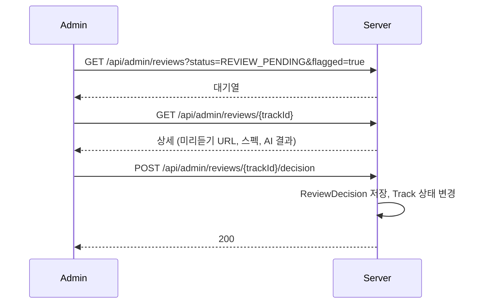

# [REVIEW-001] 음원 검수 대기열

| 항목 | 내용 |
|---|---|
| 버전 | v0.0.1 |
| 구분 | MVP 1 — 운영자 백오피스 |
| 상태 | 기획 (엔티티, enum만 있음) |

## 1. 개요
- **목적**: 운영자가 자동 처리를 마친 음원을 확인하고 공개 여부를 결정한다.
- **사용자 스토리**: "운영자로서, AI가 문제 있다고 본 곡부터 빠르게 듣고 승인하거나 반려하고 싶다."

## 2. 범위
- 포함: 대기열 목록/필터, 검수 상세(미리듣기, 메타데이터, 커버, 파일 스펙, AI 결과), 승인/반려/수정 요청/보류
- 제외: 크리에이터 제재, 신고 처리 (README "나중에 확장")

## 3. 기능 요구사항
| ID | 요구사항 | 우선순위 |
|---|---|---|
| REVIEW-001-1 | 음원명, 크리에이터명, 업로드 일시, 검수 상태, 부적절 콘텐츠 탐지 여부로 필터링한다 | Must |
| REVIEW-001-2 | 기본 정렬은 부적절 탐지 우선, 그다음 오래된 순이다 | Should |
| REVIEW-001-3 | 상세에서 미리듣기, 메타데이터, 커버 이미지, 파일 스펙, AI 분석 결과를 본다 | Must |
| REVIEW-001-4 | 승인(`APPROVED`)하면 배포 단계로 넘어가 음원이 `PUBLISHED`가 된다 | Must |
| REVIEW-001-5 | 반려(`REJECTED`)할 때 사유는 필수다 | Must |
| REVIEW-001-6 | 수정 요청(`REVISION_REQUESTED`)할 때 사유는 필수다 | Must |
| REVIEW-001-7 | 임시 보류(`PENDING`)하면 대기열에 남되 "보류" 상태로 표시한다 | Must |
| REVIEW-001-8 | 모든 결정은 운영자 ID, 결정, 사유, 시각과 함께 이력으로 남는다 | Must |

## 4. 비즈니스 규칙 / 정책
| 결정 | 음원 상태 | 크리에이터 조치 |
|---|---|---|
| 승인 | `PUBLISHED` | 없음 |
| 반려 | `REJECTED` | 사유 확인 후 재제출 가능 ([TRACK-003](track-resubmit.md)) |
| 수정 요청 | (신규 상태 필요) | 사유 확인 후 재제출 |
| 보류 | `REVIEW_PENDING` 유지 | 없음 |

- 검수 대상은 `REVIEW_PENDING` 음원이다.
- 이미 결정된(승인/반려/수정 요청) 음원은 다시 결정할 수 없다. 공개 후 내리기는 신고 관리 범위다.
- AI 분석이 실패한 음원도 운영자가 원하면 검수할 수 있고, 상세에 "AI 결과 없음"을 표시한다.

## 5. 처리 흐름


## 6. API 명세 (제안) · 모두 `ADMIN` 전용

### 6-1. 대기열
`GET /api/admin/reviews?title=&creator=&from=&to=&status=REVIEW_PENDING&flagged=true&page=0&size=20`

```json
{
  "content": [
    { "trackId": 12, "title": "Midnight Drive", "creatorNickname": "user_1a2b3c4d", "uploadedAt": "2026-11-07T12:00:00",
      "reviewStatus": "REVIEW_PENDING", "onHold": false, "inappropriateFlag": true }
  ],
  "page": 0, "size": 20, "totalElements": 1
}
```

### 6-2. 검수 상세
`GET /api/admin/reviews/{trackId}`

```json
{
  "trackId": 12,
  "metadata": { "title": "Midnight Drive", "genre": "Pop", "description": "첫 싱글", "lyrics": null },
  "creator": { "userId": 3, "nickname": "user_1a2b3c4d" },
  "previewUrl": "https://...", "coverUrl": "https://...",
  "fileSpec": { "format": "audio/wav", "durationSec": 213, "bitrate": 1411, "sizeBytes": 37580963 },
  "aiAnalysis": { "inappropriateFlag": true, "categories": ["욕설"], "lyricsText": "..." },
  "history": [ { "decision": "PENDING", "reason": "확인 필요", "adminNickname": "admin", "decidedAt": "..." } ]
}
```

### 6-3. 결정
`POST /api/admin/reviews/{trackId}/decision`

```json
{ "decision": "REJECTED", "reason": "가사에 욕설이 포함되어 있습니다." }
```

**에러**
| HTTP | 발생 조건 |
|---|---|
| 400 | 반려/수정 요청인데 사유 없음, 사유 500자 초과 |
| 403 | `ADMIN`이 아님 |
| 404 | 음원 없음 |
| 409 | `REVIEW_PENDING`이 아닌 음원 |

## 7. 데이터
- `review_decisions`: `track_id`, `user_id`(운영자), `decision`, `reason`(500자), `created_at`

## 8. 예외 및 엣지 케이스
- 운영자 두 명이 동시에 다른 결정 → 먼저 처리된 것만 반영, 나머지는 409 (Track 상태 조건부 업데이트)

## 9. 비기능 요구사항
- 대기열 필터는 페이지네이션 필수, 크리에이터명 검색은 닉네임 인덱스 사용

## 10. 인수 조건
- [ ] Given REVIEW_PENDING 음원 / When 승인 / Then PUBLISHED가 되고 결정 이력이 남는다
- [ ] Given REVIEW_PENDING 음원 / When 사유 없이 반려 / Then 400
- [ ] Given REVIEW_PENDING 음원 / When 사유와 함께 반려 / Then REJECTED가 되고 크리에이터가 사유를 볼 수 있다
- [ ] Given REVIEW_PENDING 음원 / When 보류 / Then 대기열에 남고 onHold=true
- [ ] Given 이미 승인된 음원 / When 반려 / Then 409
- [ ] Given flagged=true 필터 / When 대기열 조회 / Then 부적절 탐지된 음원만 반환한다

## 11. 미결 사항
- `TrackStatus`에 "수정 요청" 상태가 없다. 반려와 구분할지 정해야 한다.
- "보류"를 `DecisionType.PENDING`으로만 표현하면 대기열 필터를 위해 매번 최신 결정을 조인해야 한다. Track에 보류 여부를 둘지 정해야 한다.

## 12. 변경 이력
| 버전 | 내용 |
|---|---|
| v0.0.1 | 최초 작성 |
