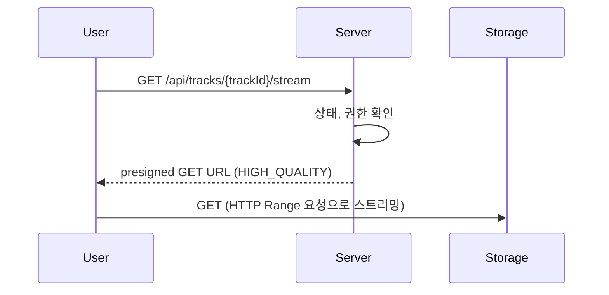

# [PLAY-001] 음원 재생

| 항목 | 내용 |
|---|---|
| 버전 | v0.0.1 |
| 구분 | MVP 2 — 일반 사용자 |
| 상태 | 기획 |

## 1. 개요
- **목적**: 사용자가 공개된 음원을 재생한다.
- **사용자 스토리**: "일반 사용자로서, 공개된 곡을 끊김 없이 듣고 싶다."

## 2. 범위
- 포함: 공개 음원 목록 조회, 재생 URL 발급
- 제외: 음원 검색, 좋아요, 플레이리스트, 재생 수 통계 (README "나중에 확장")

## 3. 기능 요구사항
| ID | 요구사항 | 우선순위 |
|---|---|---|
| PLAY-001-1 | `PUBLISHED` 상태인 음원만 목록에 보이고 재생할 수 있다 | Must |
| PLAY-001-2 | 재생은 트랜스코딩된 고음질 파일(`HIGH_QUALITY`)의 짧은 유효기간 presigned GET URL로 한다 | Must |
| PLAY-001-3 | 원본 파일(`ORIGINAL`)은 재생 URL로 내주지 않는다 | Must |
| PLAY-001-4 | 크리에이터 본인과 운영자는 공개 전 음원도 재생할 수 있다 | Should |

## 4. 비즈니스 규칙 / 정책
- **재생 권한**: 공개 음원은 로그인 사용자 누구나. 비공개 음원은 소유 크리에이터, `ADMIN`만.
- 재생 URL 유효시간: 제안 10분 (곡 길이보다 짧으면 만료 시 다시 요청)
- 공개 후 운영자가 비공개 처리하면 새 URL 발급이 즉시 막힌다. (이미 발급된 URL은 만료까지 유효)

## 5. 처리 흐름


## 6. API 명세 (제안)

### 6-1. 공개 음원 목록
`GET /api/tracks/public?page=0&size=20` · 최신 공개순

```json
{
  "content": [
    { "trackId": 12, "title": "Midnight Drive", "creatorNickname": "user_1a2b3c4d", "genre": "Pop", "thumbnailUrl": "https://...", "durationSec": 213 }
  ],
  "page": 0, "size": 20, "totalElements": 1
}
```

### 6-2. 재생 URL 발급
`GET /api/tracks/{trackId}/stream`

```json
{ "streamUrl": "https://minio.../tracks/12/hq/...?X-Amz-...", "expiresInSec": 600 }
```

**에러**
| HTTP | 발생 조건 |
|---|---|
| 403 | 공개되지 않은 음원이고 소유자/운영자가 아님 |
| 404 | 음원 없음 또는 `HIGH_QUALITY` 파일 없음 |

## 7. 데이터
- `track_files`의 `HIGH_QUALITY`, `THUMBNAIL_OPTIMIZED` 사용

## 8. 예외 및 엣지 케이스
- 비공개 음원에 대해 403 대신 404를 줄지 (존재 여부 노출 방지) → 제안: 404

## 9. 비기능 요구사항
- 스토리지가 HTTP Range 요청을 지원해야 탐색(seek)이 가능하다.

## 10. 인수 조건
- [ ] Given 공개 음원 / When 재생 요청 / Then 200과 HIGH_QUALITY 파일 URL을 반환한다
- [ ] Given 검수 대기 음원, 일반 사용자 / When 재생 요청 / Then 404를 반환한다
- [ ] Given 검수 대기 음원, 소유 크리에이터 / When 재생 요청 / Then 200을 반환한다
- [ ] Given 공개 음원 3개, 반려 음원 1개 / When 공개 목록 조회 / Then 3개만 반환한다

## 11. 미결 사항
- 비로그인 사용자도 재생할 수 있게 할지 (현재 보안 설정상 `/api/auth/**` 외 모든 API는 인증 필요)

## 12. 변경 이력
| 버전 | 내용 |
|---|---|
| v0.0.1 | 최초 작성 |
