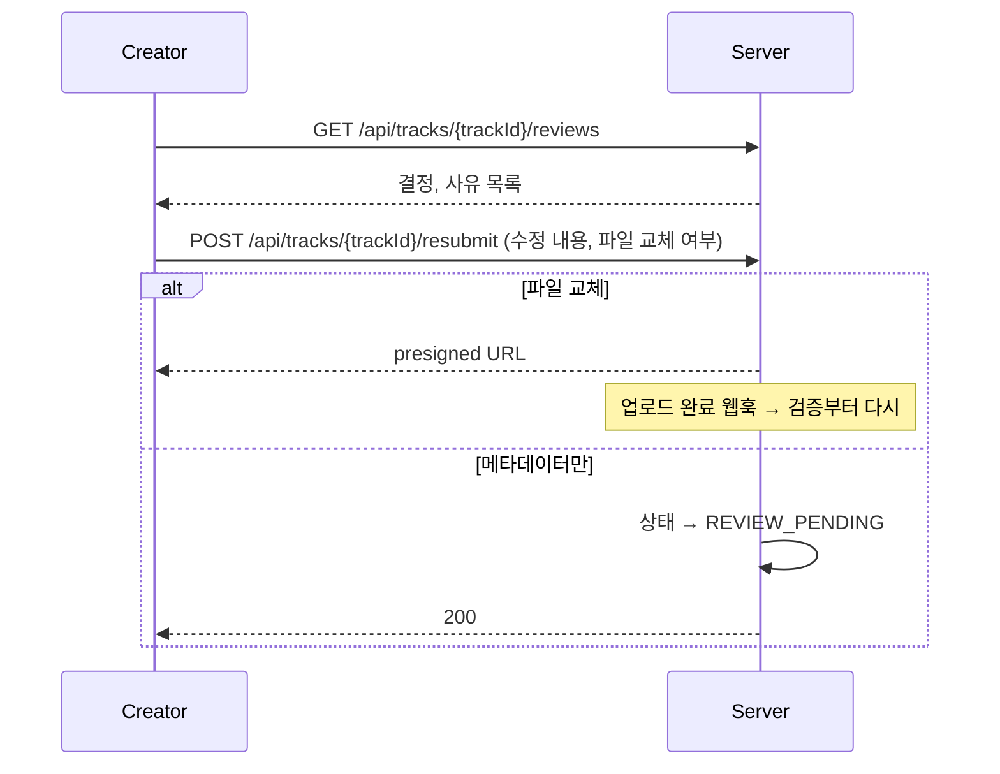

# [TRACK-003] 반려 사유 확인 및 재제출

| 항목 | 내용 |
|---|---|
| 버전 | v0.0.1 |
| 구분 | MVP 2 — 크리에이터 |
| 상태 | 기획 |

## 1. 개요
- **목적**: 반려되거나 수정 요청을 받은 크리에이터가 사유를 보고 고쳐서 다시 제출한다.
- **사용자 스토리**: "크리에이터로서, 왜 반려됐는지 알고 고쳐서 다시 올리고 싶다."

## 2. 범위
- 포함: 검수 이력(결정, 사유) 조회, 메타데이터/파일 수정 후 재제출
- 제외: 운영자에게 이의 제기(소명) — README "신고 관리"에서 다룸

## 3. 기능 요구사항
| ID | 요구사항 | 우선순위 |
|---|---|---|
| TRACK-003-1 | 크리에이터는 본인 음원의 검수 결정과 사유를 최신순으로 볼 수 있다 | Must |
| TRACK-003-2 | `REJECTED` 또는 수정 요청 상태인 음원만 재제출할 수 있다 | Must |
| TRACK-003-3 | 재제출 시 메타데이터(제목, 장르, 설명)를 수정할 수 있다 | Must |
| TRACK-003-4 | 재제출 시 음원 파일/커버 이미지를 새로 올릴 수 있다 (presigned URL 재발급) | Must |
| TRACK-003-5 | 파일을 바꾸면 검증 단계부터, 메타데이터만 바꾸면 검수 단계부터 다시 시작한다 | Should |

## 4. 비즈니스 규칙 / 정책
- 운영자가 반려/수정 요청할 때 사유는 필수다. ([REVIEW-001](review-queue.md))
- 이전 검수 이력은 지우지 않고 쌓는다.
- 재제출 횟수 제한: 미결 (아래 참고)

## 5. 처리 흐름


## 6. API 명세 (제안)

### 6-1. 검수 이력 조회
`GET /api/tracks/{trackId}/reviews` · 본인 음원만

```json
[
  { "decision": "REJECTED", "reason": "가사에 욕설이 포함되어 있습니다.", "decidedAt": "2026-11-07T12:00:00" }
]
```

### 6-2. 재제출
`POST /api/tracks/{trackId}/resubmit` · 본인 음원만

**Request**
```json
{
  "title": "Midnight Drive (Clean)",
  "genre": "Pop",
  "description": "클린 버전",
  "replaceAudio": true,
  "audioFileName": "midnight_clean.wav",
  "audioContentType": "audio/wav",
  "replaceThumbnail": false
}
```

**Response** `200 OK`: 파일을 교체하면 `audioUploadUrl` 등 presigned URL을 포함한다.

**에러**
| HTTP | 발생 조건 |
|---|---|
| 403 | 본인 음원이 아님 |
| 404 | 음원 없음 |
| 409 | 재제출할 수 없는 상태 (처리 중, 검수 대기, 공개) |

## 7. 데이터
- `review_decisions`: `track_id`, `user_id`(운영자), `decision`, `reason`, `created_at`
- 파일 교체 시 기존 TrackFile은 보관할지 삭제할지 미결

## 8. 예외 및 엣지 케이스
- 재제출 직후 다시 재제출 요청 → 이미 처리 중이므로 409
- 파일 교체를 요청했지만 업로드하지 않음 → 상태가 바뀌지 않아야 한다 (업로드 완료 웹훅에서 상태 전이)

## 9. 비기능 요구사항
- 반려 사유는 크리에이터에게 보이는 문구이므로 운영자 내부 메모와 분리한다.

## 10. 인수 조건
- [ ] Given 반려된 본인 음원 / When 검수 이력 조회 / Then 결정과 사유를 반환한다
- [ ] Given 반려된 음원 / When 메타데이터만 바꿔 재제출 / Then 상태가 `REVIEW_PENDING`이 된다
- [ ] Given 반려된 음원 / When 파일 교체로 재제출 / Then presigned URL을 반환하고, 업로드 후 검증부터 다시 시작한다
- [ ] Given 공개된 음원 / When 재제출 / Then 409를 반환한다
- [ ] Given 다른 사람 음원 / When 재제출 / Then 403을 반환한다

## 11. 미결 사항
- 재제출 횟수 제한을 둘지
- 교체 전 원본 파일 보관 기간

## 12. 변경 이력
| 버전 | 내용 |
|---|---|
| v0.0.1 | 최초 작성 |
