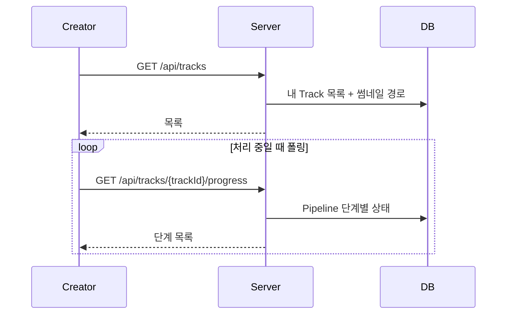

# [TRACK-002] 처리 상태 확인

| 항목 | 내용 |
|---|---|
| 버전 | v0.0.1 |
| 구분 | MVP 2 — 크리에이터 |
| 상태 | 일부 구현 (내 음원 목록) |

## 1. 개요
- **목적**: 크리에이터가 올린 곡이 파이프라인의 어느 단계에 있는지 확인한다.
- **사용자 스토리**: "크리에이터로서, 내 곡이 지금 검증 중인지, 검수 대기 중인지 알고 싶다."

## 2. 범위
- 포함: 내 음원 목록 조회, 음원 하나의 단계별 진행 상태 조회
- 제외: SSE/WebSocket 실시간 푸시 (README "나중에 확장"), 알림

## 3. 기능 요구사항
| ID | 요구사항 | 우선순위 | 구현 |
|---|---|---|---|
| TRACK-002-1 | 로그인한 크리에이터 본인의 음원 목록을 최신순으로 조회한다 | Must | ✅ |
| TRACK-002-2 | 목록에 썸네일(presigned GET URL), 제목, 상태, 등록일시를 보여준다 | Must | ✅ |
| TRACK-002-3 | 음원 하나의 단계별(검증→트랜스코딩→AI분석→검수→배포) 상태를 조회한다 | Must | ❌ |
| TRACK-002-4 | 실패한 단계가 있으면 크리에이터가 이해할 수 있는 실패 사유를 보여준다 | Should | ❌ |
| TRACK-002-5 | 다른 사람의 음원 상태는 조회할 수 없다 | Must | ❌ |

## 4. 비즈니스 규칙 / 정책
- "실시간"은 MVP에서 클라이언트 폴링(예: 5초 간격)으로 구현한다.
- 크리에이터에게는 내부 오류 코드 대신 사용자용 메시지를 보여준다. (예: `FILE_CORRUPTED` → "파일이 손상되어 열 수 없어요")

## 5. 처리 흐름


## 6. API 명세

### 6-1. 내 음원 목록 (구현됨)
`GET /api/tracks` · 인증 필요

**Response** `200 OK` (현재 `BaseResponse`로 감싸지 않음)
```json
[
  {
    "trackId": 12,
    "thumbnailUrl": "https://minio.../tracks/12/thumbnail/cover.png?X-Amz-...",
    "title": "Midnight Drive",
    "status": "UPLOADED",
    "createdAt": "2026-11-07T12:00:00"
  }
]
```

### 6-2. 단계별 진행 상태 (제안)
`GET /api/tracks/{trackId}/progress` · 인증 필요 (본인 음원만)

**Response** `200 OK`
```json
{
  "trackId": 12,
  "trackStatus": "REVIEW_PENDING",
  "stages": [
    { "stage": "VALIDATION",   "status": "COMPLETED", "message": null },
    { "stage": "TRANSCODING",  "status": "COMPLETED", "message": null },
    { "stage": "AI_ANALYSIS",  "status": "COMPLETED", "message": null },
    { "stage": "REVIEW",       "status": "WAITING",   "message": null },
    { "stage": "DISTRIBUTION", "status": "WAITING",   "message": null }
  ]
}
```

**에러**
| HTTP | 발생 조건 |
|---|---|
| 403 | 본인 음원이 아님 |
| 404 | 음원 없음 |

## 7. 데이터
- `pipeline`: `track_id`, `stage`, `status`, `retry_count`, `error_code`

## 8. 예외 및 엣지 케이스
- 업로드 직후라 Pipeline 행이 아직 없으면 모든 단계를 `WAITING`으로 보여준다.

## 9. 비기능 요구사항
- 목록 조회 시 썸네일 조회를 한 번의 쿼리로 묶는다. (N+1 방지, 현재 구현됨)

## 10. 인수 조건
- [ ] Given 음원 2개를 올린 크리에이터 / When 목록 조회 / Then 최신순으로 2개를 반환한다
- [ ] Given 음원이 없는 크리에이터 / When 목록 조회 / Then 빈 배열을 반환한다
- [ ] Given 트랜스코딩 중인 음원 / When 진행 상태 조회 / Then VALIDATION=COMPLETED, TRANSCODING=PROCESSING을 반환한다
- [ ] Given 다른 사람의 trackId / When 진행 상태 조회 / Then 403을 반환한다

## 11. 미결 사항
- `TrackStatus`(UPLOADED/REVIEW_PENDING/PUBLISHED/REJECTED)에는 "처리 중", "처리 실패", "수정 요청", "보류" 상태가 없다. 크리에이터 화면에 무엇을 보여줄지 정하고 enum을 보강해야 한다.

## 12. 변경 이력
| 버전 | 내용 |
|---|---|
| v0.0.1 | 최초 작성 |
