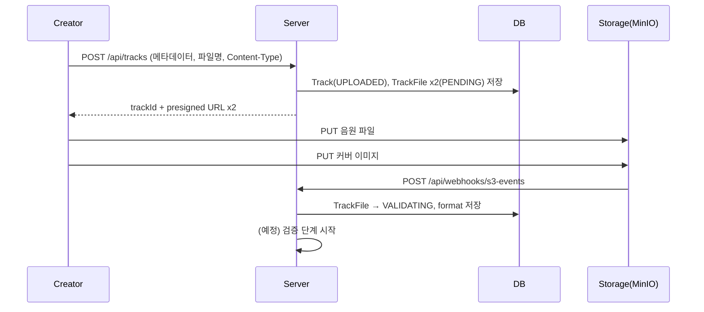

# [TRACK-001] 음원 업로드

| 항목 | 내용 |
|---|---|
| 버전 | v0.0.1 |
| 구분 | MVP 2 — 크리에이터 |
| 상태 | 일부 구현 (등록 요청, S3 업로드 완료 웹훅) |

## 1. 개요
- **목적**: 크리에이터가 음원 파일, 메타데이터, 커버 이미지를 올려 처리 파이프라인을 시작한다.
- **사용자 스토리**: "크리에이터로서, 내가 만든 곡을 올리고 공개되기까지 기다리고 싶다."

## 2. 범위
- 포함: 메타데이터 저장, 파일 업로드용 presigned URL 발급, 업로드 완료 감지 후 검증 단계 시작
- 제외: 앨범(여러 곡 묶음), 예약 공개, 업로드 진행률 표시

## 3. 기능 요구사항
| ID | 요구사항 | 우선순위 | 구현 |
|---|---|---|---|
| TRACK-001-1 | `CREATOR` 역할만 음원을 등록할 수 있다 | Must | ✅ |
| TRACK-001-2 | 제목(필수), 장르(필수), 설명(선택)을 저장하고 음원 상태를 `UPLOADED`로 만든다 | Must | ✅ |
| TRACK-001-3 | 음원/커버 이미지를 스토리지에 직접 올릴 presigned PUT URL을 발급한다 (유효 10분) | Must | ✅ |
| TRACK-001-4 | 스토리지의 업로드 완료 이벤트를 받아 해당 파일을 `VALIDATING`으로 바꾸고 포맷을 저장한다 | Must | ✅ |
| TRACK-001-5 | 업로드 완료 후 파이프라인 검증 단계([PIPE-002](pipeline-validate.md))를 시작한다 | Must | ❌ |
| TRACK-001-6 | 음원 파일 확장자를 mp3, wav로 제한한다 | Should | ❌ |
| TRACK-001-7 | 커버 이미지 확장자를 jpg, png, webp로 제한한다 | Should | ❌ |

## 4. 비즈니스 규칙 / 정책
- 파일은 서버를 거치지 않고 클라이언트가 스토리지(MinIO/S3)에 직접 올린다.
- 스토리지 경로: `tracks/{trackId}/audio/{파일명}`, `tracks/{trackId}/thumbnail/{파일명}`
- 음원 하나에 원본 파일 2개(`ORIGINAL`, `THUMBNAIL_ORIGINAL`)가 `PENDING` 상태로 먼저 생성된다.

## 5. 처리 흐름


## 6. API 명세

### 6-1. 음원 등록 요청 (구현됨)
`POST /api/tracks` · 인증 필요 (`CREATOR`)

**Request**
```json
{
  "title": "Midnight Drive",
  "genre": "Pop",
  "description": "첫 싱글",
  "audioFileName": "midnight.wav",
  "audioContentType": "audio/wav",
  "thumbnailFileName": "cover.png",
  "thumbnailContentType": "image/png"
}
```

**Response** `200 OK` (현재 `BaseResponse`로 감싸지 않음)
```json
{
  "trackId": "12",
  "audioUploadUrl": "https://minio.../tracks/12/audio/midnight.wav?X-Amz-...",
  "thumbnailUploadUrl": "https://minio.../tracks/12/thumbnail/cover.png?X-Amz-...",
  "expiresInSec": 600
}
```

**에러**
| HTTP | 코드 | 발생 조건 |
|---|---|---|
| 400 | (공통 검증 오류) | 필수 값 누락 |
| 401 | | 토큰 없음 |
| 403 | GLOBAL_403 | `CREATOR`가 아님 |

### 6-2. 업로드 완료 웹훅 (구현됨, 내부용)
`POST /api/webhooks/s3-events` · 스토리지 → 서버. S3 이벤트 알림 형식(`Records[].s3.object.key`)을 받는다.

## 7. 데이터
- `tracks`: `user_id`, `title`, `genre`, `description`, `lyrics`, `status`
- `track_files`: `file_category`(AUDIO/IMAGE), `file_type`, `storage_path`, `format`, `file_process_status`

## 8. 예외 및 엣지 케이스
- presigned URL을 받고 10분 안에 업로드하지 않으면 음원은 `UPLOADED` + 파일 `PENDING` 상태로 남는다. → 정리 정책 필요
- 같은 파일명을 다시 올리면 같은 경로를 덮어쓴다.

## 9. 비기능 요구사항
- 대용량 파일이 서버 메모리를 거치지 않도록 presigned URL 방식을 유지한다.

## 10. 인수 조건
- [ ] Given CREATOR 토큰과 올바른 메타데이터 / When 등록 요청 / Then 200, trackId, presigned URL 2개를 반환하고 Track이 `UPLOADED`로 저장된다
- [ ] Given USER 토큰 / When 등록 요청 / Then 403을 반환한다
- [ ] Given 제목 없음 / When 등록 요청 / Then 400을 반환한다
- [ ] Given 업로드 완료 이벤트 / When 웹훅 수신 / Then 해당 TrackFile이 `VALIDATING`이 되고 format이 저장된다
- [ ] Given 등록되지 않은 key의 이벤트 / When 웹훅 수신 / Then 처리하지 않고 오류를 반환한다

## 11. 미결 사항
- **웹훅에 인증이 없다.** `/api/webhooks/s3-events`가 `permitAll`이라 누구나 가짜 이벤트를 보내 파일 상태를 바꿀 수 있다. 공유 비밀 헤더나 MinIO 웹훅 인증 토큰 검증이 필요하다.
- 등록되지 않은 key일 때 `ENDPOINT_NOT_FOUND`(GLOBAL_404) 오류를 쓰고 있다. 전용 오류 코드가 필요하다.
- 업로드 기한이 지난 `PENDING` 파일과 음원을 언제 정리할지 정해야 한다.

## 12. 변경 이력
| 버전 | 내용 |
|---|---|
| v0.0.1 | 최초 작성 |
