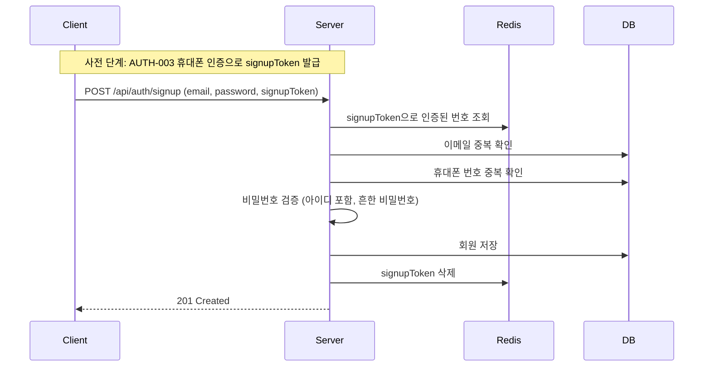

# [AUTH-001] 회원가입

| 항목 | 내용 |
|---|---|
| 버전 | v0.0.2 |
| 상태 | 완료 |
| 이전 버전 | [v0.0.1/auth-signup.md](../v0.0.1/auth-signup.md) |

## 1. 개요
- **목적**: 휴대폰 본인 인증을 마친 사용자만 가입하게 해서, 번호 하나당 계정 하나로 제한한다.
- **사용자 스토리**: "휴대폰 인증을 마친 사용자로서, 이메일과 비밀번호로 가입하고 싶다."

## 2. 범위
- 포함: signupToken 검증, 이메일/휴대폰 번호 중복 검사, 강화된 비밀번호 규칙
- 제외: 이메일 인증, 닉네임 직접 입력

## 3. 기능 요구사항
v0.0.1의 AUTH-001-1 ~ AUTH-001-5는 유지하고, 아래가 추가/변경됩니다.

| ID | 요구사항 | 구분 |
|---|---|---|
| AUTH-001-3 | 비밀번호 규칙을 만족하지 않으면 가입할 수 없다 (규칙 강화) | 변경 |
| AUTH-001-6 | 휴대폰 인증에서 받은 유효한 `signupToken`이 있어야 가입할 수 있다 | 신규 |
| AUTH-001-7 | 이미 가입된 휴대폰 번호로는 가입할 수 없다 | 신규 |
| AUTH-001-8 | 비밀번호에 이메일 아이디(@ 앞부분)를 포함할 수 없다 | 신규 |
| AUTH-001-9 | 흔한 비밀번호 목록에 있는 비밀번호는 쓸 수 없다 | 신규 |
| AUTH-001-10 | 가입이 끝나면 signupToken을 삭제한다 (1회용) | 신규 |

## 4. 비즈니스 규칙 / 정책
- **비밀번호 규칙**: 8~64자, 영어 **대문자·소문자**·숫자·특수문자를 각각 1개 이상 포함, 공백 불가
- 이메일 아이디가 3자 이상일 때만 포함 여부를 검사한다. (대소문자 구분 없음)
- 흔한 비밀번호 목록: `src/main/resources/common-passwords.txt` (대소문자 구분 없음)
- 이메일이 중복되면 signupToken을 **삭제하지 않는다.** 다른 이메일로 바로 다시 시도할 수 있게 하기 위함이다.
- 가입한 회원은 `phone`이 저장되고 `phoneVerified = true`가 된다.

## 5. 처리 흐름


## 6. API 명세
`POST /api/auth/signup`

**Request**
```json
{
  "email": "user@example.com",
  "password": "Mx7#qPz9!",
  "signupToken": "3f2a...-uuid"
}
```

**Response** `201 Created`
```json
{
  "isSuccess": true,
  "status": 201,
  "code": "CREATED_201",
  "message": "생성에 성공하였습니다.",
  "result": {
    "id": 1,
    "email": "user@example.com",
    "nickname": "user_1a2b3c4d",
    "role": "USER"
  },
  "timeStamp": "2026-11-07 12:00:00"
}
```

**에러**
| HTTP | 코드 | 발생 조건 |
|---|---|---|
| 400 | (공통 검증 오류) | 필드 누락, 이메일 형식 오류, 비밀번호 규칙 위반 |
| 400 | AUTH_400_3 | signupToken 만료 또는 유효하지 않음 |
| 400 | AUTH_400_4 | 비밀번호에 이메일 아이디 포함 |
| 400 | AUTH_400_5 | 흔한 비밀번호 |
| 409 | AUTH_409_1 | 이미 가입된 이메일 |
| 409 | AUTH_409_3 | 이미 가입된 휴대폰 번호 |

## 7. 데이터
- `users` 테이블: `phone`, `phone_verified` 값 저장
- Redis: `sms:signup:{token}` 조회 후 삭제

## 8. 예외 및 엣지 케이스
- signupToken이 유효한 10분 동안 같은 번호로 다른 가입이 먼저 끝날 수 있다 → 가입 시점에 휴대폰 번호 중복을 다시 확인한다.

## 9. 비기능 요구사항
- v0.0.1과 같음

## 10. 인수 조건
- [ ] Given 유효한 signupToken, 새 이메일, 규칙에 맞는 비밀번호 / When 회원가입 요청 / Then 201과 함께 회원이 생성되고 signupToken이 삭제된다
- [ ] Given signupToken 없음 / When 회원가입 요청 / Then 400을 반환한다
- [ ] Given 만료되었거나 이미 사용한 signupToken / When 회원가입 요청 / Then 400(AUTH_400_3)을 반환한다
- [ ] Given 대문자가 없는 비밀번호 / When 회원가입 요청 / Then 400을 반환한다
- [ ] Given 이메일 `soundhub@example.com`, 비밀번호 `Soundhub1!` / When 회원가입 요청 / Then 400(AUTH_400_4)을 반환한다
- [ ] Given 흔한 비밀번호 목록에 있는 비밀번호 / When 회원가입 요청 / Then 400(AUTH_400_5)을 반환한다
- [ ] Given 이미 가입된 이메일 / When 회원가입 요청 / Then 409(AUTH_409_1)를 반환하고 signupToken은 유지된다
- [ ] Given 이미 가입된 휴대폰 번호의 signupToken / When 회원가입 요청 / Then 409(AUTH_409_3)를 반환한다

## 11. 변경 이력
| 버전 | 내용 |
|---|---|
| v0.0.1 | 이메일/비밀번호 회원가입 |
| v0.0.2 | 휴대폰 인증(signupToken) 필수화, 휴대폰 번호 중복 차단, 비밀번호 규칙 강화 |
