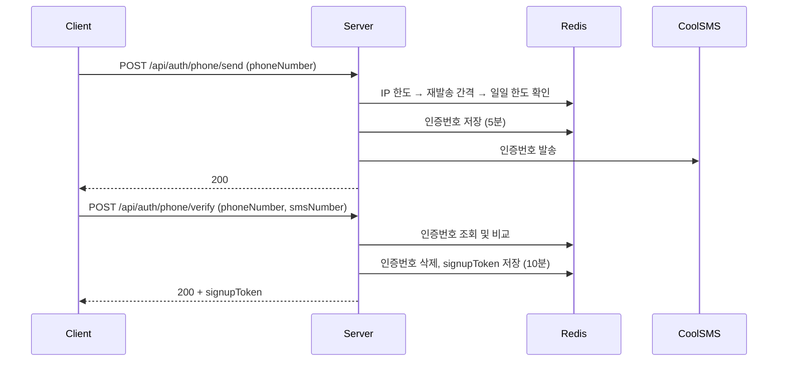

# [AUTH-003] 휴대폰 SMS 인증

| 항목 | 내용 |
|---|---|
| 버전 | v0.0.2 |
| 상태 | 완료 |

## 1. 개요
- **목적**: 회원가입 전에 휴대폰 본인 인증을 해서, 번호 하나당 계정 하나만 만들도록 한다.
- **사용자 스토리**: "회원가입하려는 사용자로서, 내 휴대폰 번호로 받은 인증번호로 본인 인증을 하고 싶다."

## 2. 범위
- 포함: 인증번호 발송, 인증번호 확인, 회원가입용 1회용 토큰(`signupToken`) 발급, 발송 횟수 제한
- 제외: 해외 번호, 음성 인증, 가입 후 번호 변경

## 3. 기능 요구사항
| ID | 요구사항 | 우선순위 |
|---|---|---|
| AUTH-003-1 | 휴대폰 번호로 6자리 인증번호를 SMS로 발송한다 | Must |
| AUTH-003-2 | 재발송 간격, 번호당 일일 횟수, IP당 시간당 횟수를 제한한다 | Must |
| AUTH-003-3 | 인증번호가 일치하면 회원가입용 1회용 `signupToken`을 발급한다 | Must |
| AUTH-003-4 | 인증번호를 5번 틀리면 인증번호를 폐기한다 | Must |
| AUTH-003-5 | 이미 가입된 번호는 인증 단계에서 차단한다 | Must |

## 4. 비즈니스 규칙 / 정책
| 항목 | 값 |
|---|---|
| 번호 형식 | 하이픈 없는 숫자, `01[016789]` + 7~8자리 |
| 인증번호 | 숫자 6자리 (SecureRandom) |
| 인증번호 유효시간 | 5분 |
| 재발송 간격 | 15초 (Redis TTL 기준) |
| 번호당 발송 한도 | 하루 10회 |
| IP당 발송 한도 | 1시간 20회 |
| 오답 허용 | 5회 (5회째에 인증번호 폐기) |
| signupToken 유효시간 | 10분, 1회용 |

- 다른 사람 번호의 재발송 간격을 잡지 못하도록 **IP 한도를 먼저 확인**한다.
- 새 인증번호를 발송하면 이전 오답 횟수는 초기화된다.
- SMS 발송에 실패하면 저장한 인증번호를 삭제한다.
- 인증에 성공한 인증번호는 바로 삭제해서 다시 쓸 수 없게 한다.

## 5. 처리 흐름


## 6. API 명세

### 6-1. 인증번호 발송
`POST /api/auth/phone/send`

**Request**
```json
{ "phoneNumber": "01012345678" }
```

**Response** `200 OK` (data 없음)

**에러**
| HTTP | 코드 | 발생 조건 |
|---|---|---|
| 400 | (공통 검증 오류) | 번호 누락 또는 형식 오류 |
| 429 | AUTH_429_1 | 재발송 간격 미충족 |
| 429 | AUTH_429_2 | 번호당 일일 한도 또는 IP당 시간당 한도 초과 |
| 502 | AUTH_502_1 | SMS 발송 실패 |

### 6-2. 인증번호 확인
`POST /api/auth/phone/verify`

**Request**
```json
{ "phoneNumber": "01012345678", "smsNumber": "123456" }
```

**Response** `200 OK`
```json
{ "signupToken": "3f2a...-uuid" }
```

**에러**
| HTTP | 코드 | 발생 조건 |
|---|---|---|
| 400 | (공통 검증 오류) | 번호/인증번호 누락 또는 형식 오류 |
| 400 | AUTH_400_1 | 인증번호 만료 (또는 발송한 적 없음) |
| 400 | AUTH_400_2 | 인증번호 불일치 |
| 409 | AUTH_409_3 | 이미 가입된 휴대폰 번호 |
| 429 | AUTH_429_3 | 인증번호 5회 오답 |

## 7. 데이터
| Redis 키 | 값 | TTL |
|---|---|---|
| `sms:code:{phone}` | 인증번호 | 5분 |
| `sms:attempt:{phone}` | 오답 횟수 | 5분 |
| `sms:cooldown:{phone}` | 재발송 잠금 | 15초 |
| `sms:daily:{phone}` | 일일 발송 횟수 | 1일 |
| `sms:ip:hour:{ip}` | IP 시간당 발송 횟수 | 1시간 |
| `sms:signup:{token}` | 인증된 휴대폰 번호 | 10분 |

## 8. 예외 및 엣지 케이스
- 인증번호를 다시 받으면 이전 인증번호는 무효가 된다.
- 횟수 카운터는 INCR과 만료 설정을 Lua 스크립트로 한 번에 실행해, 만료 없는 키가 남지 않게 한다.

## 9. 비기능 요구사항
- SMS 발송은 외부 API 호출이므로 DB 트랜잭션 없이 실행한다. (커넥션 점유 방지)
- 인증번호는 응답이나 로그에 남기지 않는다.

## 10. 인수 조건
- [ ] Given 올바른 번호 / When 발송 요청 / Then 200을 반환하고 SMS가 발송된다
- [ ] Given 형식이 틀린 번호 / When 발송 요청 / Then 400을 반환한다
- [ ] Given 15초 안에 같은 번호로 재요청 / When 발송 요청 / Then 429(AUTH_429_1)를 반환한다
- [ ] Given 같은 번호로 하루 10회 발송 / When 11번째 발송 요청 / Then 429(AUTH_429_2)를 반환한다
- [ ] Given SMS 발송 실패 / When 발송 요청 / Then 502를 반환하고 인증번호를 삭제한다
- [ ] Given 올바른 인증번호 / When 확인 요청 / Then 200과 signupToken을 반환한다
- [ ] Given 틀린 인증번호 / When 확인 요청 / Then 400(AUTH_400_2)을 반환한다
- [ ] Given 4번 틀린 상태 / When 5번째로 틀린 인증번호 입력 / Then 429(AUTH_429_3)를 반환하고 인증번호를 폐기한다
- [ ] Given 만료된 인증번호 / When 확인 요청 / Then 400(AUTH_400_1)을 반환한다
- [ ] Given 이미 가입된 번호 / When 올바른 인증번호로 확인 요청 / Then 409(AUTH_409_3)를 반환한다

## 11. 미결 사항
- 재발송 간격: 코드의 Redis TTL은 **15초**인데, 오류 메시지(`AUTH_429_1`)와 코드 주석에는 **10초**로 적혀 있다. 하나로 맞춰야 한다.

## 12. 변경 이력
| 버전 | 내용 |
|---|---|
| v0.0.2 | 최초 작성 |
